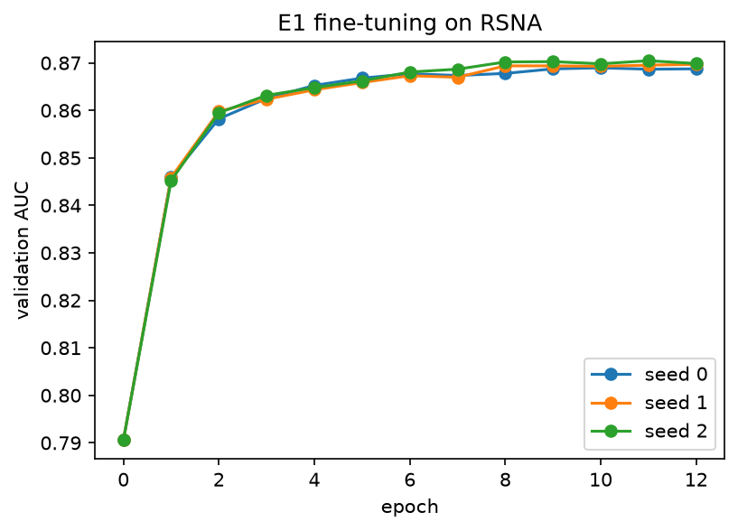

# Is the model looking at the lungs? Detecting and fixing view bias in a chest X-ray classifier with XAI

**Author:** Xabier Albizu Arias
**Status:** 🚧 Stage 3 of 6 complete (fine-tuning and bias diagnosis)

## TL;DR

Deep learning models for chest X-rays can be right for the wrong reasons. Instead of the lung opacity, they may rely on *shortcuts* such as the acquisition view (AP portable vs. PA standing), text markers or medical devices. These shortcuts work inside the training hospital and break when the patient mix changes.

This project takes a **pretrained DenseNet-121** (TorchXRayVision, trained on CheXpert), fine-tunes it for lung-opacity detection on the **RSNA Pneumonia** dataset, and uses **explainability** to:

1. **Diagnose** whether the model depends on the view. ✅ It does: among healthy patients, AP films get higher opacity scores than PA films, and at a screening threshold **18.4 % of healthy AP vs 2.8 % of healthy PA** studies are flagged.
2. **Locate** where the bias comes from: cues outside the lungs (text, devices) or AP projection physics inside the lungs. Tools: Grad-CAM, HiResCAM, Integrated Gradients, linear probes and lung-masking tests, all validated first with sanity checks.
3. **Fix** it with interventions chosen by that diagnosis: lung-masked input, a *Right for the Right Reasons* loss, or view-balanced reweighting.
4. **Measure** the fix with three pre-registered metrics: within-view AUC, view leakage and the false-positive gap between healthy AP and PA studies.

The full plan and frozen evaluation protocol are in [`docs/PROYECTO.md`](docs/PROYECTO.md).

## Repository structure

```text
xai-cxr-shortcuts/
├── README.md              # this file, updated stage by stage
├── pyproject.toml         # makes src/ installable (pip install -e .)
├── requirements.txt
├── data/README.md         # how to obtain the data (not redistributed)
├── docs/
│   ├── PROYECTO.md        # project plan and frozen evaluation protocol
│   └── figures/           # figures used in this README
├── notebooks/             # one notebook per stage, imports from src/
│   ├── 01_eda.ipynb
│   ├── 02_baselines.ipynb
│   └── 03_finetune.ipynb
├── results/               # aggregated metrics only (no per-patient data)
├── splits/
│   └── patient_splits.csv # patientId + split (no labels)
└── src/
    ├── data.py            # labels, DICOM metadata, data root discovery
    ├── splits.py          # patient-level stratified splits
    ├── preprocess.py      # DICOM -> 224 px uint8 memory-mapped cache
    ├── dataset.py         # PyTorch dataset over the cache
    ├── models.py          # TorchXRayVision DenseNet + single-logit head
    ├── train.py           # fine-tuning loop, checkpoints, history
    ├── metrics.py         # bootstrap AUC, AUC by subgroup
    └── utils.py           # device selection (CUDA / MPS / CPU)
```

Not versioned: DICOMs, image cache, labels, predictions and checkpoints (`data/`, `checkpoints/`).

## Setup

**Local (evaluation and explanations).**

```bash
python -m venv .venv-xai && source .venv-xai/bin/activate
pip install -r requirements.txt
pip install -e .
```

Then follow [`data/README.md`](data/README.md) to download the RSNA data.

**Kaggle (training).** Attach the RSNA competition as input and enable a GPU:

```python
!git clone -q https://github.com/xabieralbizu2/V1_XRay_xAI /kaggle/working/xai-cxr-shortcuts
!pip install -q torchxrayvision pydicom
import sys; sys.path.insert(0, "/kaggle/working/xai-cxr-shortcuts")
```

The exact training cells are documented at the top of `notebooks/03_finetune.ipynb`.

## Data

[RSNA Pneumonia Detection Challenge](https://www.kaggle.com/c/rsna-pneumonia-detection-challenge) (Kaggle, 2018): frontal chest X-rays from the NIH ChestX-ray14 dataset, annotated by radiologists with bounding boxes of pneumonia-related lung opacities. DICOM headers provide view position, sex and age.

## Progress log

### Stage 1 — Exploratory analysis by subgroup ✅

**Goal.** Before training anything, check whether the dataset contains a spurious correlation the model could exploit.

**How.** `src/data.py` builds one row per patient from the labels file and the DICOM headers (no pixel data). Notebook: `notebooks/01_eda.ipynb`.

**Results.** 26,684 patients, overall prevalence of lung opacity 22.5%.

| Subgroup | Patients | Prevalence |
|---|---:|---:|
| AP view | 12,173 | **38.3%** |
| PA view | 14,511 | **9.3%** |
| Female | 11,518 | 21.7% |
| Male | 15,166 | 23.1% |
| Age < 40 | 9,044 | 25.5% |
| Age 40–65 | 14,167 | 20.7% |
| Age > 65 | 3,468 | 22.5% |

| View | Lung Opacity | No Lung Opacity / Not Normal | Normal |
|---|---:|---:|---:|
| AP | 38.3% | 48.2% | 13.4% |
| PA | 9.3% | 41.0% | 49.7% |

**Conclusions.**

- **The view is a strong potential shortcut.** AP images have 4.1× the prevalence of PA images. A rule that only looks at the view would reach an AUC of about 0.71 (computed analytically from the counts above) without seeing the lungs.
- AP images are rarely normal (13% vs. 50% in PA), because AP portable films are taken on sicker, bedridden patients. "Looking like an AP film" is therefore highly predictive of "not normal".
- Sex and age show small differences in prevalence. They are not strong shortcuts but will be used for the fairness analysis.
- 5 patients have invalid ages (0 or > 120) and are excluded.

**Decision.** The shortcut hypothesis is plausible, so the project continues with the main plan.

### Stage 2a — Splits, metadata-only baseline (B1) and image cache ✅

**Splits.** Patient-level 70/15/15 split stratified by target × view, after removing the 5 patients with invalid ages. All experiments use the same assignment (`splits/patient_splits.csv`).

| Split | Patients | Prevalence | AP share |
|---|---:|---:|---:|
| Train | 18,675 | 22.5% | 45.6% |
| Validation | 4,002 | 22.5% | 45.6% |
| Test | 4,002 | 22.5% | 45.6% |

**B1: logistic regression on view, sex and age only (no image).** Test ROC-AUC with 95% bootstrap CI:

| Subset | AUC |
|---|---|
| Overall | 0.727 [0.709, 0.746] |
| Within AP | 0.552 [0.524, 0.578] |
| Within PA | 0.545 [0.504, 0.588] |

**Conclusions.**

- Metadata alone reaches an AUC of 0.73 without looking at the image. Almost all of it comes from the view: within each view the AUC drops to ~0.55.
- This "high overall, near-chance within group" pattern is the signature of a pure shortcut model. *(Stage 3 shows that the overall-to-within-view drop is not enough to detect a partial shortcut in an image model; see "Lesson learned" below.)*
- Visual inspection shows that AP images carry visible cues (ECG leads, lines, tubes, text markers) even when the label is negative.

**Image cache.** The 26,679 DICOMs were resized once to 224×224 `uint8` (~1.3 GB, memory-mapped) in `data/processed/`.

### Stage 2b — Zero-shot pretrained model (E0) ✅

DenseNet-121 from TorchXRayVision trained **only on CheXpert** (`densenet121-res224-chex`), evaluated as is on the RSNA test split. It saw no NIH or RSNA images, so there is no test leakage. Test ROC-AUC with 95% bootstrap CI:

| Model | Overall | Within AP | Within PA |
|---|---|---|---|
| B1 (metadata only) | 0.727 [0.709, 0.746] | 0.552 [0.524, 0.578] | 0.545 [0.504, 0.588] |
| E0 `Lung Opacity` output | **0.779** [0.762, 0.794] | 0.695 [0.670, 0.719] | 0.747 [0.713, 0.778] |
| E0 `Pneumonia` output | 0.749 [0.732, 0.766] | 0.692 [0.667, 0.715] | 0.724 [0.687, 0.760] |

**Conclusions.**

- The pretrained model relies on image content. Its AUC stays at 0.70–0.75 within each view, while the metadata baseline collapses to ~0.55.
- AP images are harder (0.695 vs 0.747). AP negatives are rarely normal (13%), so separating pneumonia from other findings is harder than in PA.
- The `Lung Opacity` output matches the RSNA label best and is used as the E0 reference.

### Stage 3 — Fine-tuning (E1) and view-bias diagnosis ✅

**Training.** E0 was fine-tuned on the RSNA training split with a single "opacity" head initialised from its *Lung Opacity* unit. Settings: AdamW (backbone 1e-4, head 1e-3), warm-up + cosine schedule, augmentation without horizontal flip, early stopping on validation AUC, 3 seeds × 12 epochs on a Kaggle T4 (~104 s/epoch). Validation AUC rose from 0.791 (epoch 0 = E0) to 0.870, with all seeds agreeing to within 0.001.



**Test AUC** (E1 = mean of 3 seeds):

| Model | Overall | AP only | PA only |
|---|---|---|---|
| B1 (metadata only) | 0.727 | 0.552 | 0.545 |
| E0 (pretrained) | 0.779 | 0.695 | 0.747 |
| E1 (fine-tuned) | **0.865** [0.852, 0.877] | **0.817** [0.798, 0.836] | **0.824** [0.797, 0.851] |

E1 is a much better classifier than E0, also within each view. But does it use the view?

**Naive stress test (confounded).** We split the test set into *aligned* (AP positives + PA negatives) and *inverted* (PA positives + AP negatives). The AUC falls from 0.96 to 0.52, which looks like a collapse. But the two sets also differ in difficulty: AP negatives are mostly *No Lung Opacity / Not Normal* (only 14 % Normal vs 48 % in PA), and PA lesions are half the size (median box area 58k vs 110k px²). With *Normal* negatives only, inverted AUC recovers to 0.81 for both E0 and E1.

**View leakage.** Among *Normal* studies only, how well does the score separate AP from PA? (0.5 = the score ignores the view.)

| Model | View leakage (AUC) |
|---|---|
| E0 | 0.627 [0.587, 0.666] |
| E1 | **0.785 [0.755, 0.814]** |

**Practical impact.** At a screening threshold set on validation (90 % sensitivity, probability 0.106):

| Class | View | n | Flagged as opacity |
|---|---|---:|---:|
| Normal | AP | 250 | **18.4 %** |
| Normal | PA | 1,052 | **2.8 %** |
| Lung Opacity | AP | 700 | 96.0 % |
| Lung Opacity | PA | 202 | 71.8 % |

A healthy AP patient is 6.6× more likely to get a false alarm than a healthy PA patient. (The sensitivity gap is partly confounded by lesion size, so the Normal rows are the clean comparison.)

**Lesson learned.** Within-view AUC only compares patients of the same view, so it cannot see a constant "AP bonus" added to every AP image. The bias only appears when patients from different views are compared. This is why view leakage and the Normal false-positive gap replace the overall-to-within-view drop as primary metrics (see `docs/PROYECTO.md`, section 5).

**Conclusion.** Fine-tuning on RSNA improved detection **and** amplified the dependence on view. A healthy AP film receives a higher opacity score than a healthy PA film. The bias can come from three sources:

- **H1:** cues outside the lungs (text, devices).
- **H2:** AP projection physics inside the lungs.
- **H3:** less reliable *Normal* labels in AP.

Stage 4 is designed to tell H1 and H2 apart.

### Stage 4 — Explanations, sanity checks and bias localisation ⏳

Lung masks, parameter-randomisation sanity checks, Grad-CAM / HiResCAM / Integrated Gradients, lung attribution fraction, linear probe for view, and lung-masking tests with pre-registered decision rules.

### Stage 5 — Interventions (E2 lung mask, E3 RRR, E4 view reweighting) ⏳

### Stage 6 — Final evaluation and report ⏳

## References

- Zech, J. R. et al. (2018). Variable generalization performance of a deep learning model to detect pneumonia in chest radiographs. *PLOS Medicine*.
- DeGrave, A. J., Janizek, J. D. and Lee, S.-I. (2021). AI for radiographic COVID-19 detection selects shortcuts over signal. *Nature Machine Intelligence*.
- Cohen, J. P. et al. (2022). TorchXRayVision: A library of chest X-ray datasets and models. *MIDL*.
- Ross, A. S., Hughes, M. C. and Doshi-Velez, F. (2017). Right for the right reasons. *IJCAI*.
- Adebayo, J. et al. (2018). Sanity checks for saliency maps. *NeurIPS*.

## License

Code: MIT (to be confirmed). Data: subject to the RSNA Pneumonia Detection Challenge rules.
