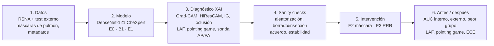

# ¿Mira el modelo al pulmón? Detección y corrección de atajos en un clasificador de radiografías de tórax mediante explicabilidad

**Proyecto final de Explicabilidad de la IA** · Máster en Inteligencia Artificial Avanzada, ICAI · Curso 2026/2027  
**Autor:** Xabier Albizu Arias  
**Estado:** propuesta inicial (v0.1, 11/11/2026)

> **La idea en una frase.** Un modelo de radiografías puede acertar por motivos equivocados (la proyección del aparato, marcas de texto, dispositivos médicos) en lugar de por la imagen del pulmón. Este proyecto usa la explicabilidad para *medir* cuánto ocurre eso, *corregirlo* y demostrar con números que la corrección hace al modelo más fiable fuera de su hospital de origen.

Las cifras de los datasets y los detalles de API marcados con *(verificar)* están escritos de memoria y hay que comprobarlos en la fuente.

## Índice

1. Resumen ejecutivo
2. Problema y motivación
3. Formulación de la tarea
4. Datos
5. Modelos y diseño experimental
6. Explicabilidad: técnicas y por qué
7. Uso accionable de las explicaciones
8. Evaluación crítica de la explicabilidad
9. Referencias
10. Registro de cambios

## 1. Resumen ejecutivo

Los modelos de deep learning para radiografía de tórax alcanzan AUC cercanos a 0,9 en su propio hospital, pero suelen caer al desplegarse en otro. Una causa documentada es el *shortcut learning*: el modelo aprende señales que correlacionan con la etiqueta en los datos de entrenamiento pero que no son la enfermedad. Por ejemplo, la proyección AP (radiografía portátil en cama, típica de pacientes graves), las marcas de texto del equipo o los drenajes torácicos.

**Qué haré.** Tomaré un DenseNet-121 preentrenado en CheXpert (librería TorchXRayVision) y lo adaptaré a detectar opacidad pulmonar compatible con neumonía en el dataset RSNA Pneumonia, que trae cajas dibujadas por radiólogos. Evaluaré en un test interno y en un test externo de otra institución.

**Cómo usaré la explicabilidad.**

1. **Diagnóstico.** Con Grad-CAM, gradientes integrados (IG) y oclusión mediré qué fracción de la atribución cae dentro de los pulmones y si coincide con las cajas de los radiólogos. Con sondas lineales sobre las representaciones internas mediré si el modelo codifica la proyección AP/PA, el sexo o la edad.
2. **Validación de las explicaciones.** Antes de creerlas, pasaré los sanity checks de aleatorización de parámetros, curvas de borrado/inserción y acuerdo entre métodos.
3. **Corrección.** Si el diagnóstico confirma el atajo, reentrenaré con dos intervenciones motivadas por él: entrada enmascarada a los pulmones y una pérdida *Right for the Right Reasons* que penaliza la atribución fuera de los pulmones.
4. **Antes y después.** Compararé AUC global, AUC por subgrupo (AP, PA, sexo), AUC externo, peor subgrupo y las métricas de explicación del paso 1.

**Hipótesis principal.** El modelo ajustado de forma estándar dedica una fracción relevante de su atribución a regiones extrapulmonares y su rendimiento depende de la proyección. Las intervenciones guiadas por explicabilidad aumentan la fracción de atribución en pulmón y mejoran el rendimiento en el test externo y en el peor subgrupo, con un coste pequeño o nulo en el test interno.

**Por qué es un buen proyecto.** Cubre las secciones 4.1 (mejora del modelo con antes/después) y 4.3 (subgrupos y robustez), tiene métricas de explicación con verdad de terreno (las cajas de los radiólogos), y aborda un problema real y conocido de la IA médica. Si la hipótesis resulta falsa, el resultado sigue siendo publicable en el informe: un modelo que *sí* mira al pulmón, demostrado con sanity checks.

## 2. Problema y motivación

### 2.1. El fenómeno: acertar por la razón equivocada

El *shortcut learning* (Geirhos et al., 2020) aparece cuando una regla sencilla separa las clases en los datos de entrenamiento pero no es la regla que buscamos. En radiografía de tórax está bien documentado:

| Estudio | Hallazgo |
|---|---|
| Zech et al. (2018), *PLOS Medicine* | Una CNN de neumonía identificaba el hospital de origen casi perfectamente y usaba esa información; su rendimiento caía en hospitales externos. |
| DeGrave, Janizek y Lee (2021), *Nature Machine Intelligence* | Modelos de COVID-19 se apoyaban en marcas de texto, bordes y posición del paciente; al cambiar de fuente de datos el rendimiento se desplomaba. |
| Oakden-Rayner et al. (2020), *ACM CHIL* | En neumotórax, gran parte de los positivos ya tienen tubo de drenaje; el modelo rinde mucho peor en neumotórax sin drenaje, que son justo los que importan. |
| Gichoya et al. (2022), *Lancet Digital Health* | Los modelos pueden predecir la raza autodeclarada a partir de la radiografía, aunque los humanos no sepan cómo; riesgo de sesgos ocultos. |
| Seyyed-Kalantari et al. (2021), *Nature Medicine* | Clasificadores de rayos X infradiagnostican más a subgrupos (mujeres, pacientes jóvenes, ciertos grupos raciales). |

El mecanismo más probable en neumonía es la **proyección**. Una radiografía PA (posteroanterior) se hace de pie en la sala de rayos; una AP (anteroposterior) suele hacerse con un equipo portátil en la cama de un paciente demasiado enfermo para levantarse. Las AP tienen, por tanto, más prevalencia de patología, y además se ven distintas: el corazón parece más grande, la escápula se superpone al pulmón, hay cables, monitores y letras del equipo portátil. Un modelo puede aprender "AP implica probablemente enfermo" sin mirar la opacidad.

### 2.2. Stakeholder y por qué importa la explicabilidad

- **Stakeholder principal: el comité de validación de un servicio de radiología** (radiólogo jefe, físico médico y responsable de calidad) que decide si adoptar un modelo entrenado fuera de su hospital. Necesita saber si el modelo funcionará con *sus* pacientes, y para eso necesita entender en qué se basa.
- **Stakeholder secundario: el radiólogo que usa el sistema a diario.** Un mapa de calor sobre el pulmón afectado le ayuda a calibrar su confianza; un mapa sobre la etiqueta del aparato le advierte de que la predicción no es clínica.
- **Marco regulatorio.** Un software de diagnóstico es un producto sanitario (Reglamento UE 2017/745, MDR) y por ello un sistema de IA de alto riesgo según el Reglamento de IA de la UE (AI Act). Para estos sistemas se exige transparencia suficiente para que el usuario interprete la salida (art. 13) y supervisión humana efectiva (art. 14). La explicabilidad no es un extra: es una forma de cumplir y de auditar.

La explicabilidad aquí cumple tres funciones, y conviene nombrarlas en el informe: **depuración** (encontrar el atajo), **validación** antes del despliegue (¿generalizará?) y **confianza calibrada** del usuario final.

## 3. Formulación de la tarea

| Elemento | Definición |
|---|---|
| Entrada | Radiografía de tórax frontal (AP o PA), en escala de grises, redimensionada a 224 × 224 píxeles. |
| Salida | Probabilidad de *opacidad pulmonar compatible con neumonía* (clasificación binaria por imagen). |
| Objetivo de entrenamiento | Minimizar la entropía cruzada binaria (con pesos de clase si hace falta). |
| Métrica principal | ROC-AUC en el test interno y en el test externo, con intervalo de confianza bootstrap del 95 %. |
| Métricas secundarias | PR-AUC, sensibilidad a especificidad fija del 80 %, AUC por subgrupo (proyección, sexo, edad), AUC del peor subgrupo, error de calibración (ECE). |
| Métricas de explicación | Fracción de atribución dentro de los pulmones, *pointing game* frente a las cajas de los radiólogos, AUC de borrado/inserción. |

*Por qué binaria y no las 14 patologías de CheXpert:* simplifica el análisis y tenemos verdad de terreno espacial (cajas) solo para esta clase. Con una clase bien estudiada se puede profundizar en la explicabilidad, que es lo que se evalúa.

## 4. Datos

### 4.1. Dataset principal: RSNA Pneumonia Detection Challenge

- **Origen.** Competición de Kaggle de 2018 organizada por la Radiological Society of North America, con anotaciones de radiólogos sobre imágenes del dataset NIH ChestX-ray14. Enlace: <https://www.kaggle.com/c/rsna-pneumonia-detection-challenge>.
- **Tamaño.** Unas 26.700 radiografías frontales de entrenamiento con etiqueta, de las que aproximadamente un 22 % tiene al menos una caja de opacidad *(verificar)*.
- **Formato.** DICOM de 1024 × 1024. La cabecera DICOM incluye `ViewPosition` (AP/PA), `PatientSex` y `PatientAge`: estos metadatos son los que permiten el análisis por subgrupos.
- **Etiquetas.** `Target = 1` si hay opacidad compatible con neumonía, con una o más cajas `(x, y, width, height)`. Existe además un fichero de clases detalladas con tres categorías: *Lung Opacity*, *Normal* y *No Lung Opacity / Not Normal*. Esta última es importante: son pacientes con otras anomalías y deben ir en negativos.
- **Licencia.** Uso según las reglas de la competición; para un trabajo académico es habitual, pero cita la fuente y revisa las condiciones.

**Comprobación previa obligatoria.** Antes de nada, calcula la prevalencia de `Target = 1` en AP frente a PA. Si es mucho mayor en AP (lo esperable *(verificar)*), ya tienes la correlación espuria potencial que justifica el proyecto, y es la primera figura del informe.

### 4.2. Test externo

El test externo debe venir de otra institución. Opciones, de más a menos recomendable:

| Dataset | Por qué | Pegas |
|---|---|---|
| **SIIM-FISABIO-RSNA COVID-19 Detection** (Kaggle 2021) | Cajas de opacidad dibujadas por radiólogos; parte de las imágenes viene del BIMCV de Valencia, otro sistema sanitario. Permite *pointing game* externo. | La tarea es COVID; hay que mapear "opacidad sí/no" a partir de las cajas y de la clase *negative*. |
| **PadChest** (BIMCV, Hospital San Juan de Alicante) | Más de 160.000 radiografías españolas con etiquetas que incluyen neumonía. Encaja con un stakeholder español. | Requiere solicitud de acceso; etiquetas extraídas de informes (más ruidosas); sin cajas. |
| **Chest X-Ray Images (Pneumonia)**, Kermany et al., Kaggle | Fácil de descargar. | Pacientes pediátricos de un único hospital chino: el cambio de dominio es tan grande que mezcla población y equipo. Solo como último recurso. |

**Importante:** los pesos de TorchXRayVision deben no haber visto ninguno de tus tests. Por eso se usan los pesos entrenados solo con CheXpert (Stanford). Los pesos `all` incluyen RSNA y NIH *(verificar en la documentación de la librería)* y contaminarían la evaluación.

### 4.3. Preprocesado

1. Leer el DICOM con `pydicom` y aplicar, si existe, `PhotometricInterpretation = MONOCHROME1` (invertir la imagen) para que el hueso sea siempre claro.
2. Normalizar al rango que espera TorchXRayVision: valores en $[-1024, 1024]$ con su función `xrv.datasets.normalize`.
3. Redimensionar a 224 × 224 con recorte central (la librería trae `XRayCenterCrop` y `XRayResizer`).
4. **Máscaras de pulmón**: generarlas una vez con el modelo de segmentación de la propia librería (PSPNet entrenado en ChestX-Det) y guardarlas en disco. Revisar a mano 30–50 al azar y descartar las fallidas; anotar cuántas se descartan.
5. **Split por paciente**, estratificado por etiqueta y proyección: 70 % entrenamiento, 15 % validación, 15 % test. En RSNA hay una imagen por paciente, pero conviene hacerlo por `patientId` igualmente por si se combinan fuentes.
6. **Aumentación de datos** solo en entrenamiento: rotaciones pequeñas (±10°), escalado (±10 %), traslación, brillo y contraste. **Nunca volteo horizontal**: el corazón está a la izquierda, y voltear crea anatomías imposibles (y puede romper el *pointing game* si las cajas no se voltean también).

## 5. Modelos y diseño experimental

### 5.1. Modelo preentrenado

DenseNet-121 de TorchXRayVision con pesos `densenet121-res224-chex` (entrenado en CheXpert, unas 220.000 radiografías del Stanford Hospital). Entre sus salidas están *Lung Opacity* y *Pneumonia*, por lo que puede evaluarse directamente (zero-shot) sobre RSNA.

**Detalle técnico a vigilar.** Los modelos de la librería, por defecto, recalibran sus salidas con umbrales operativos (`op_threshs`), de modo que lo que devuelven no son logits. Para entrenar con BCE y para calcular atribuciones necesitas los logits: desactiva esa normalización (por ejemplo `model.op_threshs = None`) y aplica tú la sigmoide *(verificar en la versión que instales)*.

*Flujo del proyecto: los pasos 3 y 4 diagnostican con explicabilidad; los pasos 5 y 6 corrigen y miden la mejora.*

### 5.2. Experimentos

Cada experimento se repite con **3 semillas** y se informa de la media y la desviación. Todos se evalúan en el mismo test interno y externo.

| ID | Experimento | Qué cambia | Para qué |
|---|---|---|---|
| E0 | Zero-shot | Nada: salida *Lung Opacity* del modelo CheXpert | Punto de partida sin adaptación |
| B1 | Baseline simple | Regresión logística sobre los metadatos (proyección, sexo, edad) | Cuánto se puede acertar **sin mirar la imagen**: si es alto, el atajo existe en los datos |
| E1 | Fine-tuning estándar (ERM) | Ajuste completo con BCE sobre RSNA | Modelo principal a explicar |
| E2 | Entrada enmascarada | Igual que E1, pero los píxeles fuera del pulmón se ponen a 0 o se difuminan | Intervención 1: quitar el acceso al atajo |
| E3 | *Right for the Right Reasons* | E1 + penalización de los gradientes de entrada fuera del pulmón | Intervención 2: enseñar dónde mirar sin cambiar la entrada |
| E4 *(opcional)* | Rebalanceo por grupo | Muestreo que iguala la prevalencia en AP y PA, o Group DRO | Comparar la corrección guiada por XAI con una corrección clásica de robustez |

El baseline B1 es muy valioso para el informe: si un modelo que solo ve la proyección consigue un AUC de, digamos, 0,65, has demostrado con un número que el atajo es posible.

### 5.3. Protocolo de entrenamiento (E1–E3)

- Optimizador AdamW, *learning rate* $10^{-4}$ para el backbone y $10^{-3}$ para la cabeza, *weight decay* $10^{-4}$, *cosine schedule* con 1 época de *warm-up*.
- 10–15 épocas, *batch size* 32–64, precisión mixta. Parada temprana por AUC de validación con paciencia 3.
- Selección de modelo e hiperparámetros solo con validación. El test se ejecuta **una vez por experimento**, al final.
- Coste orientativo: en una GPU tipo T4 (Colab), unos minutos por época para E1 y E2; E3 cuesta 2–3 veces más por la doble retropropagación.

### 5.4. Evaluación estadística

- Intervalos del 95 % por bootstrap estratificado (2.000 remuestreos) para AUC, sensibilidad y métricas de explicación.
- Comparación de AUC entre modelos sobre el mismo test con el test de DeLong o con bootstrap pareado.
- Sin mezclar semillas y bootstrap de forma confusa: presenta la variabilidad entre semillas y el intervalo de cada semilla por separado, o explica cómo los combinas.

## 6. Explicabilidad: técnicas y por qué

Qué papel juega cada técnica en el proyecto y por qué es adecuada.

| Técnica | Tipo | Papel | Por qué es adecuada |
|---|---|---|---|
| **Grad-CAM** | Local, post-hoc, basada en gradientes | Mapa principal de "dónde mira el modelo" | Estándar en imagen médica, barata, funciona con cualquier CNN; resolución baja (7 × 7 en DenseNet-121 a 224 px), suficiente para "pulmón sí/no". |
| **HiResCAM** | Local | Variante más fiel de Grad-CAM | Draelos y Carin (2020) muestran que Grad-CAM puede marcar regiones que el modelo no usa; HiResCAM garantiza fidelidad para arquitecturas con *global average pooling* y sirve como control. |
| **Gradientes integrados (IG)** | Local, a nivel de píxel | Mapa de alta resolución y con axiomas | Cumple *completitud* y *sensibilidad*; permite comparar con un método de naturaleza distinta a Grad-CAM. |
| **Oclusión** | Local, por perturbación | Comprobación independiente de gradientes | No depende de gradientes, que pueden ser ruidosos o saturados. |
| **Fracción de atribución en pulmón** | Global (agregado de locales) | Métrica numérica del atajo | Convierte miles de mapas en un número por modelo y subgrupo, medible antes y después. |
| **Pointing game** | Global, evaluación con verdad de terreno | Plausibilidad frente a radiólogos | Las cajas de RSNA permiten medir si el máximo del mapa cae en la lesión. |
| **Sondas lineales (*linear probing*)** | Global, sobre representaciones | ¿Codifica el modelo la proyección, el sexo, la edad? | Si una regresión logística sobre el *embedding* predice AP/PA con AUC 0,99, la información está ahí y puede usarse como atajo. |
| **Sanity checks** (aleatorización, borrado/inserción, acuerdo) | Evaluación | Saber si los mapas reflejan el modelo | Requisito explícito del enunciado (sección 5) y la parte que más puntúa junto con la implementación. |

### 6.1. Métricas de explicación, definidas con precisión

Sea $A \in \mathbb{R}^{H\times W}$ el mapa de atribución de una imagen (solo la parte positiva, $A^+ = \max(A, 0)$), $M$ la máscara binaria de pulmón y $B$ la máscara de la caja del radiólogo.

**Fracción de atribución en pulmón (energía):**

$$
\text{LAF}(A, M) = \frac{\sum_{i,j} A^+_{ij} M_{ij}}{\sum_{i,j} A^+_{ij}}
$$

Hay que compararla con la fracción de la imagen que ocupa el pulmón, $\bar{M} = \frac{1}{HW}\sum M_{ij}$ (típicamente 0,3–0,4). Un mapa aleatorio tendría LAF ≈ $\bar{M}$. Por eso conviene presentar también el **cociente** $\text{LAF}/\bar{M}$: un valor de 2 significa que el pulmón recibe el doble de atribución de la que le correspondería por área.

**Pointing game:** acierto si $\arg\max_{i,j} A_{ij}$ cae dentro de $B$ (con una tolerancia de unos 15 píxeles en la imagen original). Se calcula solo en positivos verdaderos. Compara con el acierto de un mapa constante centrado en el pulmón como referencia.

**Curvas de borrado e inserción** (Petsiuk et al., 2018): se eliminan (o añaden) los píxeles en orden de atribución decreciente, por bloques del 5 %, y se registra la probabilidad predicha. Un buen mapa hace caer la probabilidad deprisa al borrar (AUC de borrado baja) y subir deprisa al insertar (AUC de inserción alta). Siempre comparar contra un orden aleatorio.

## 7. Uso accionable de las explicaciones

Este es el núcleo de la nota (2 puntos directos, y alimenta los 2,5 de crítica). La cadena que el informe tiene que hacer explícita es:

> **Las explicaciones muestran X** → **por eso intervengo con Y** → **y las métricas pasan de A a B.**

### 7.1. Mejora del modelo (apartado 4.1 del enunciado)

**Diagnóstico esperado.** En E1, una LAF baja (cerca del área relativa del pulmón) en un porcentaje relevante de imágenes, mapas que se iluminan en bordes, letras o cables, y una sonda lineal que predice AP/PA casi perfectamente a partir del *embedding*. Además, AUC alto global pero bajo dentro de cada proyección por separado (señal clásica de que parte del rendimiento viene de la proyección).

**Intervención E2 (entrada enmascarada).** Multiplicar la imagen por la máscara dilatada del pulmón (dilatación de unos 10 píxeles para no cortar lesiones periféricas). Es simple y muy interpretable, pero tiene un riesgo: la *forma* de la máscara también puede correlacionar con la proyección (en AP los pulmones se ven distintos). La sonda lineal en E2 te dirá si el atajo sobrevive.

**Intervención E3 (*Right for the Right Reasons*, Ross et al., 2017).** Se mantiene la imagen completa pero se añade a la pérdida un término que penaliza el gradiente de la salida respecto a los píxeles fuera del pulmón:

$$
\mathcal{L}(\theta) = \text{BCE}(y, \hat{y}) + \lambda \sum_{i,j} (1 - M_{ij}) \left( \frac{\partial \, \text{logit}}{\partial x_{ij}} \right)^2 + \mu \lVert \theta \rVert^2
$$

El primer término pide **acertar**; el segundo pide acertar **por las razones correctas**, porque castiga que la salida dependa de píxeles fuera del pulmón ($1 - M_{ij} = 1$ fuera de la máscara); el tercero es el *weight decay* habitual.

$\lambda$ se elige en validación con una pequeña rejilla (por ejemplo $10^{-1}, 1, 10, 100$, normalizando el término para que tenga una escala comparable a la BCE) buscando el mayor $\lambda$ que no empeore el AUC de validación en más de 0,01. Variante más barata: penalizar la masa de Grad-CAM fuera del pulmón (diferenciable si se construye el grafo con `create_graph=True`).

**Tabla antes/después prevista** (los valores se rellenan con resultados reales):

| Modelo | AUC interno | AUC AP | AUC PA | AUC peor grupo | AUC externo | LAF / área | Pointing game | ECE |
|---|---|---|---|---|---|---|---|---|
| E0 Zero-shot | | | | | | | | |
| B1 Solo metadatos | | | | | — | — | — | |
| E1 ERM | | | | | | | | |
| E2 Máscara | | | | | | | | |
| E3 RRR | | | | | | | | |

Qué esperar con honestidad: es posible que el AUC interno **baje ligeramente** al quitar el atajo, porque el atajo funcionaba dentro de RSNA. Eso no es un fracaso: es la prueba de que parte del rendimiento original era espurio. El argumento se sostiene si suben el AUC externo, el peor grupo y la LAF.

### 7.2. Equidad y robustez (apartado 4.3 del enunciado)

- AUC, sensibilidad y LAF por sexo, por tramo de edad (por ejemplo < 40, 40–65, > 65) y por proyección, con intervalos bootstrap.
- Comparar los mapas medios por subgrupo: ¿mira el modelo a sitios distintos en mujeres (sombras mamarias) que en hombres?
- Ver si las intervenciones reducen la brecha entre grupos o la amplían.

### 7.3. Insight de dominio (apartado 4.2 del enunciado, complemento)

Una recomendación concreta para el comité de radiología, por ejemplo: "en radiografías AP el modelo E1 pierde X puntos de AUC y concentra un Y % de su atribución fuera del pulmón; si se adopta, debe validarse por separado en AP portátiles o usarse la versión E3". Es una acción tangible derivada de la explicación.

## 8. Evaluación crítica de la explicabilidad

Vale 2,5 puntos. Tiene que haber pruebas cuantitativas y una discusión honesta.

1. **Test de aleatorización de parámetros en cascada** (Adebayo et al., 2018). Se reinicializan las capas del modelo desde la salida hacia la entrada, una a una, y se recalculan los mapas en unas 200 imágenes. Se mide la similitud con el mapa original (correlación de rangos de Spearman y SSIM). Un método fiel debe dar mapas cada vez más distintos. Si Grad-CAM de un modelo aleatorio sigue pareciendo "un pulmón", los mapas reflejan la imagen, no el modelo. Es una de las figuras más vistosas del informe.
2. **Test de aleatorización de etiquetas** (opcional, más caro): entrenar con etiquetas barajadas y comprobar que los mapas cambian.
3. **Curvas de borrado/inserción** por método y modelo, frente a orden aleatorio.
4. **Acuerdo entre métodos**: correlación de Spearman entre Grad-CAM, HiResCAM, IG y oclusión, e IoU del 10 % de píxeles con más atribución. Explicar los desacuerdos (resolución, saturación de gradientes, efecto del *baseline* de IG).
5. **Sensibilidad al *baseline* de IG**: imagen negra (valor mínimo) frente a imagen difuminada. En rayos X "negro" significa "aire", no "ausencia de información", y esto cambia los mapas.
6. **Estabilidad**: pequeñas perturbaciones de la entrada (ruido gaussiano leve, traslaciones de 2–4 píxeles) que no cambian la predicción no deberían cambiar mucho el mapa.
7. **Incertidumbre de las explicaciones** (diferenciador acorde a tu perfil bayesiano): calcular los mapas en las 3 semillas o con *MC dropout* y mostrar la desviación por píxel, o intervalos bootstrap de la LAF. Si dos semillas del mismo modelo dan mapas muy distintos, la explicación de una sola semilla no es fiable.

**Limitaciones que el informe debe discutir:**

- Grad-CAM tiene muy baja resolución y suaviza; "cae en el pulmón" a 7 × 7 es una afirmación gruesa.
- La métrica LAF depende de la calidad de las máscaras automáticas; sus errores se trasladan a las conclusiones.
- Que un mapa caiga en el pulmón no prueba que el modelo use el motivo clínico correcto; solo descarta algunos atajos espaciales. Atajos no espaciales (contraste global, ruido del detector) no se ven en un mapa de calor.
- Las etiquetas de RSNA tienen variabilidad entre radiólogos; parte del "error" es ruido de etiqueta.
- **Riesgo de mala interpretación por el stakeholder.** Un radiólogo puede leer el mapa como "aquí está la neumonía" (localización), cuando solo indica "estos píxeles influyeron en la puntuación". Mapas convincentes generan sobreconfianza (*automation bias*). Recomendación: presentarlos siempre junto a la probabilidad calibrada y con una advertencia explícita.

## 9. Referencias

- Adebayo, J. et al. (2018). Sanity checks for saliency maps. *NeurIPS*.
- Cohen, J. P. et al. (2022). TorchXRayVision: A library of chest X-ray datasets and models. *MIDL*. <https://github.com/mlmed/torchxrayvision>
- DeGrave, A. J., Janizek, J. D. y Lee, S.-I. (2021). AI for radiographic COVID-19 detection selects shortcuts over signal. *Nature Machine Intelligence*, 3, 610–619.
- Draelos, R. L. y Carin, L. (2020). Use HiResCAM instead of Grad-CAM for faithful explanations of convolutional neural networks. arXiv:2011.08891.
- Geirhos, R. et al. (2020). Shortcut learning in deep neural networks. *Nature Machine Intelligence*, 2, 665–673.
- Gichoya, J. W. et al. (2022). AI recognition of patient race in medical imaging: a modelling study. *The Lancet Digital Health*, 4(6).
- Irvin, J. et al. (2019). CheXpert: A large chest radiograph dataset with uncertainty labels and expert comparison. *AAAI*.
- Oakden-Rayner, L. et al. (2020). Hidden stratification causes clinically meaningful failures in machine learning for medical imaging. *ACM CHIL*.
- Petsiuk, V., Das, A. y Saenko, K. (2018). RISE: Randomized input sampling for explanation of black-box models. *BMVC*.
- Ross, A. S., Hughes, M. C. y Doshi-Velez, F. (2017). Right for the right reasons: Training differentiable models by constraining their explanations. *IJCAI*.
- Sagawa, S. et al. (2020). Distributionally robust neural networks for group shifts. *ICLR*.
- Selvaraju, R. R. et al. (2017). Grad-CAM: Visual explanations from deep networks via gradient-based localization. *ICCV*.
- Seyyed-Kalantari, L. et al. (2021). Underdiagnosis bias of artificial intelligence algorithms applied to chest radiographs in under-served patient populations. *Nature Medicine*, 27.
- Shih, G. et al. (2019). Augmenting the NIH chest radiograph dataset with expert annotations of possible pneumonia. *Radiology: Artificial Intelligence*, 1(1).
- Sundararajan, M., Taly, A. y Yan, Q. (2017). Axiomatic attribution for deep networks. *ICML*.
- Zech, J. R. et al. (2018). Variable generalization performance of a deep learning model to detect pneumonia in chest radiographs. *PLOS Medicine*, 15(11).
- Reglamento (UE) 2024/1689 de Inteligencia Artificial (AI Act), arts. 6, 13 y 14.
- Reglamento (UE) 2017/745 sobre productos sanitarios (MDR).

## 10. Registro de cambios

| Versión | Fecha | Cambio |
|---|---|---|
| v0.1 | 2026-11-11 | Propuesta inicial |
